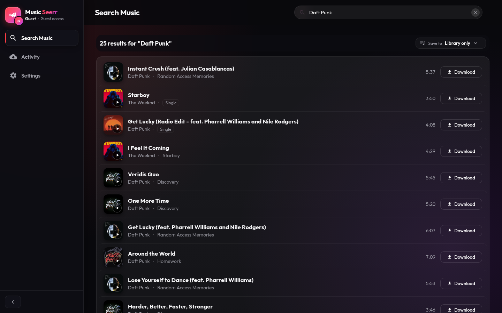
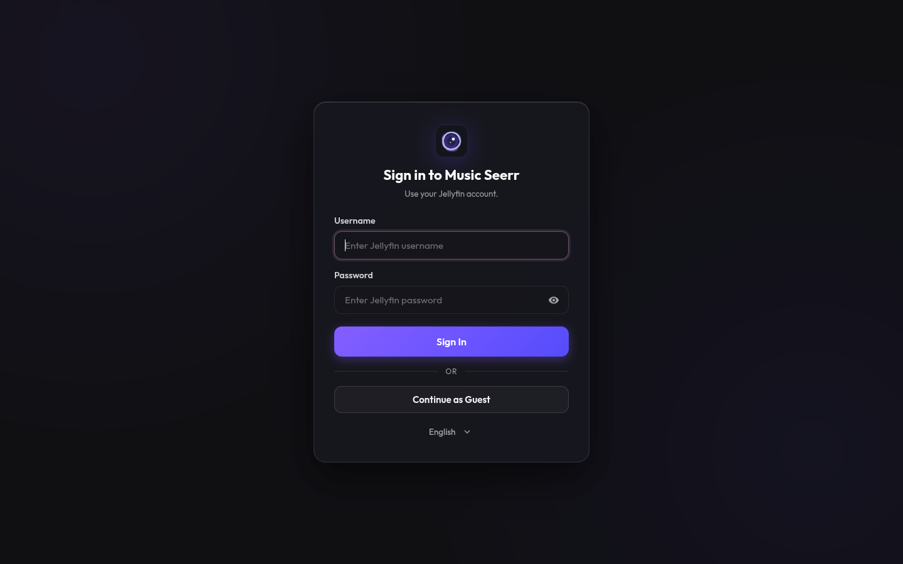
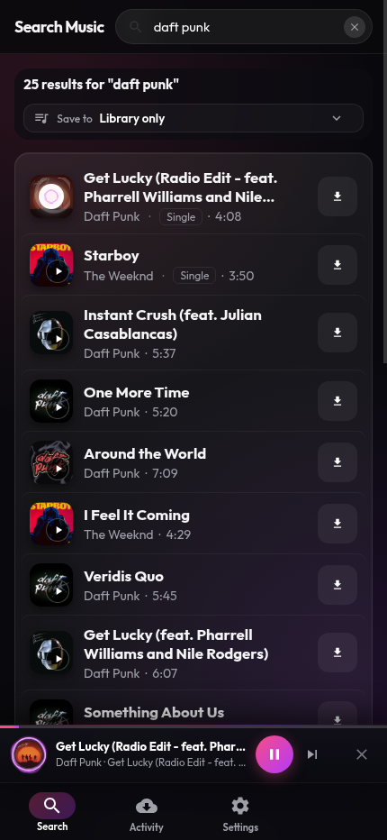

# Sonalis

[](https://github.com/giulio177/sonalis/releases)
[](https://github.com/giulio177/sonalis/pkgs/container/sonalis)
[](https://github.com/giulio177/sonalis-ios)
[](LICENSE)
[](https://buymeacoffee.com/giulio17)

Request single songs for your Jellyfin library: search, preview, download with synced lyrics, and play them from the web or iPhone.

[Why](#why) · [Features](#features) · [iOS app](#ios-app) · [Install](#install) · [Configuration](#configuration) · [Library layout](#library-layout) · [Security](#security)



## Why

Lidarr and similar tools manage whole albums and discographies. Sonalis covers what they leave out:

- **Single tracks.** Download one song without grabbing the whole album.
- **Listen first.** Preview a track before you download it.
- **Covers included.** Album art is embedded in every download; when no catalog cover exists, the video thumbnail is used.
- **Lyrics included.** Synchronized lyrics are saved as `.lrc` next to each track, and missing ones can be fetched for songs already in your library.
- **One app.** Request a song, play your Jellyfin library, and read the lyrics without switching apps.
- **Works alongside Lidarr.** Files use Lidarr's naming and tags, so both can share one library.

A companion [iOS app](#ios-app) is also available for iPhone (sideloaded via SideStore or AltStore; not on the App Store).

## Features

### Find and download

- **Search and preview** tracks before downloading; tracks already in your library are marked.
- **Right version, first time**: downloads pick the upload whose length matches the release, skipping video intros and outros.
- **Picked for you**: recommendations built from your listening history and Jellyfin playlists; full listens count more than skips, and missing tracks come first.
- **Complete your albums**: album pages list missing tracks, and artist pages show releases not yet in your library, ready to preview and download. When several editions exist, the one matching your library sets the track numbers.
- **Download queue** with live progress, cancel, retry, and per-user history.
- **Save to playlist**: send a download straight to a Jellyfin playlist.
- **In Jellyfin right away**: after a download, Jellyfin scans only that album folder, so the song appears within seconds.
- **Playlist CSV sync**: compare a CSV with a playlist, add matches, and queue missing tracks.

### Listen

- **Built-in player** for your Jellyfin library with synchronized lyrics from LRCLIB.
- **Editable queue**: play next, add to queue, drag to reorder, remove; shuffle reorders the queue itself. The queue panel shows covers and stays open while you use the player.
- **Repeat and crossfade**: loop the queue and fade songs into each other (1 to 12 seconds, synced per account).
- **One player across devices**: the web app and the [iOS app](#ios-app) of the same account share the current song, queue, and progress, and control each other. Audio plays on one device; **Play on this device** moves it.
- **Previews keep your place**: preview a song while listening, then return to the queue where you left off.
- **Reorder playlists**: drag songs in a playlist; the new order saves to Jellyfin.
- **Track menu** on every song: add to a playlist (or a new one), favorite, or jump to the artist or album.
- **Listening history** that updates live, tracks how much of each song you heard, and replays previews.
- **Jellyfin listening sync**: plays in other Jellyfin clients appear in Sonalis within seconds, and library plays here count in Jellyfin.
- **Activity overview**: downloads and plays per day, failed downloads, top playlists, and most played artists.

### Fix your library (administrators)

- **Edit file**: trim intros, outros, and silence on a waveform; the cut is lossless and synced lyrics shift with it.
- **Edit lyrics**: shift synced lyrics, fix single lines while the song plays, or time plain lyrics line by line. An administrator can let every user edit lyrics.
- **Change file**: when tags are right but the audio is wrong, pick the right track from catalog search with previews; only the audio is replaced (converted to MP3), keeping tags, cover, lyrics, and playlist entries.
- **Playlist duplicates**: spot songs added more than once, choose which copy to keep, or mark title matches as different songs.
- **Library import**: move server folders or browser uploads into the library layout, keeping the best-quality copy.
- **Library health**: find files whose name, folder, or tags disagree, then rename, move, delete, or ignore them one by one.
- **Artist aliases**: map a former or alternate artist name to your library name so older releases are found; aliases are also added automatically when an album turns up under another name.
- **Admin controls**: settings, cross-user history, and playlist management for Jellyfin administrators.

### Look and feel

- **Your color**: pick a preset or custom accent color; synced live across open web and iOS sessions for your account.
- **Live visualizer**: the logo and rings around the playing cover move with the music.
- **Guest access** for search and downloads without a Jellyfin account.
- **Mobile web layout**, English and Italian.

| Sign in with Jellyfin | Mobile |
| --- | --- |
|  |  |

## iOS app

A native companion client is available in a separate repository: [Sonalis for iOS](https://github.com/giulio177/sonalis-ios).

- **iOS only (iPhone)**: there is no Android or iPad app.
- **Not on the App Store**: installed by sideloading with [SideStore](https://sidestore.io) or [AltStore](https://altstore.io); a free Apple ID is enough.
- **iOS 26 or later**: required for the full experience (native tab bar mini player, Siri and Shortcuts, Control Center buttons, Action button, and Spotlight).
- **Online and offline**: browse your Jellyfin library, search and request songs, download tracks, albums, and playlists with synced lyrics for offline playback, and share live playback and preferences with the web app.

See the [sonalis-ios repository](https://github.com/giulio177/sonalis-ios) for the SideStore/AltStore source URL, install steps, and free Apple ID limits.

## Install

Requirements: Docker Engine with the Compose plugin and a reachable Jellyfin server.

```sh
mkdir sonalis && cd sonalis
curl -fsSLO https://raw.githubusercontent.com/giulio177/sonalis/main/docker-compose.yml
mkdir -p music backend/data
sudo chown -R 10001:10001 music backend/data
docker compose up -d
```

- The container runs as non-root UID/GID `10001`, so `music/` and `backend/data/` must be owned by `10001:10001`.
- Open `http://<server-ip>:8000` and complete the setup wizard.
- Mount the same `music/` folder into Jellyfin's music library so Jellyfin can scan downloads. To use an existing library (for example one managed by Lidarr), mount its root folder as `/music`.
- Images are published for `linux/amd64` and `linux/arm64` (including 64-bit Raspberry Pi OS) at `ghcr.io/giulio177/sonalis`.

## Configuration

### Environment variables

Set these in a `.env` file next to `docker-compose.yml`.

| Variable | Default | Purpose |
| --- | --- | --- |
| `JELLYFIN_URL` | `http://host.docker.internal:8096` | Jellyfin address as seen from the container. |
| `SONALIS_TAG` | `latest` | Image tag to run. Pin a release such as `0.1.0` for predictable updates. |
| `SONALIS_BIND` | `0.0.0.0` | Host address for port 8000. Use `127.0.0.1` behind a reverse proxy on the same host. |
| `FORWARDED_ALLOW_IPS` | `127.0.0.1` | Reverse proxy address trusted for forwarded headers. |
| `SONALIS_SECRET` | (generated) | Key that encrypts the Jellyfin tokens stored with sessions. Any long random string; if unset, a key is created in `/app/data/secret.key`. Changing it only signs users out. |

### Volumes

| Mount | Required | Purpose |
| --- | --- | --- |
| `/music` | Yes | Music library root, writable. Share it with Jellyfin. |
| `/app/data` | Yes | Configuration, sessions, history, backups, and paired CSV files. |
| `/import` | No | Extra folder (for example a downloads folder) offered in **Settings > Import into library**. |
| `/jellyfin-playlists` | No | Jellyfin's `config/data/data/playlists` folder, read-only. Lets Sonalis detect playlist owners. |

Jellyfin's API does not report playlist owners to an API key. Without `/jellyfin-playlists`, an owner is inferred only when a single account can see the playlist; otherwise an administrator selects it.

## Update

| Tag | Meaning |
| --- | --- |
| `X.Y.Z` | A specific release. |
| `X.Y` | Latest patch of that minor line. |
| `latest` | Newest release. |
| `edge` | Current `main` branch. |

Back up `backend/data` and `music`, update `SONALIS_TAG` if pinned, then run:

```sh
docker compose pull && docker compose up -d
```

- `GET /api/health` reports the running version. Releases follow Semantic Versioning.
- To build the image locally: `docker build -t ghcr.io/giulio177/sonalis:dev ./backend`, then set `SONALIS_TAG=dev`.

## Library layout

Tracks are saved as `Album Artist/Album (Year)/Album Artist - Album - NN - Title.mp3`.

- Existing artist and album folders are reused.
- A track already in its album folder is not downloaded again. The title tag decides: "Believer (Instrumental)" does not count as "Believer".
- An administrator can still force a download (**Not this song**); the new file is saved as `... (2)` next to the old one.
- Featured artists are written as separate artist tag values, so "Song (feat. Guest)" appears under both artists.

### Import existing music

An administrator opens **Settings > Import into library**, selects a server folder or uploads files, reviews the planned moves, and confirms.

- Duplicates: keep extra copies, or delete them and keep the best quality (FLAC over MP3, then higher bitrate).
- Matching `.lrc` files move with their tracks.
- Every import writes a manifest to `/app/data`.
- From a shell: `python -m app.tools.reorganize_library <folder>` (add `--apply` to move).

### Check library health

An administrator opens **Settings > Library health** and runs a scan. It reads tags only and changes nothing on its own.

| Issue | Example | Fixes |
| --- | --- | --- |
| Title differs | `03 - Believer.flac` tagged "Believer (Instrumentals)" | Rename to match tags, move under the track artist, delete |
| Wrong artist folder | Album artist tag names another artist | Move to the tag's artist, delete |
| Same track number | Two different songs both numbered `01` | Delete |

- `.lrc` files follow their tracks; every fix is logged to `/app/data/library-health.jsonl`.
- Ignored files stay hidden in later checks until ignores are cleared.

### Edit audio, lyrics, or replace a file

In any library track's menu, an administrator can:

- **Edit file**: drag start and end points on the waveform, preview, or match the release length, then cut losslessly while shifting `.lrc` lyrics in sync.
- **Edit lyrics**: shift timestamps for the whole track, edit single lines during playback, or time plain lyrics line by line.
- **Change file**: search the catalog with previews and replace only the audio (saved as MP3) while keeping tags, cover, lyrics, and playlist entries.

Audio and lyrics edits keep the previous file in `/app/data/replaced-files/` for 30 days and log changes to `/app/data/replaced-files.jsonl`.

### Tidy an existing library

`python -m app.tools.tidy_library`, run inside the container as the user owning the music files, fixes combined artist credits, album folders split by year, and artists listed under a former name.

- Dry run by default; pass `--apply` to write changes.
- `--alias "Old Name=New Name"` maps a former artist name and retags existing files. Aliases can also be managed in **Settings > Artist aliases** (for lookups and future downloads).
- `--undo <manifest>` restores the previous state.

## Security

- The web endpoint serves plain HTTP. Keep it on a trusted local network.
- For remote access, use a VPN (Tailscale, WireGuard) or a TLS reverse proxy. Do not expose port 8000 directly to the internet.
- The Jellyfin API key is stored in `backend/data`; protect that folder and its backups.
- Each signed-in account's Jellyfin token is stored encrypted with its session, never sent to the browser, and revoked in Jellyfin on sign-out or expiry. It is used only where Jellyfin refuses the API key (reordering playlist tracks).
- Set `SONALIS_SECRET` to keep the encryption key outside `backend/data`, so a copy of that folder alone cannot read tokens.
- If Jellyfin becomes unreachable, the sign-in screen can reconnect to the same server without editing files.

## Beta limitations

- External services change; setup, Jellyfin integration, and download sources can break.
- A restart interrupts active downloads; they reappear in the queue for manual retry.
- Shared playback between devices is held in memory: run a single backend process, and a restart clears the last shared queue.
- SQLite stores sessions and history for a single instance. New columns are added at startup; automatic backups are not built in yet.
- Not validated on every Raspberry Pi model or storage setup.
- Downloads depend on `yt-dlp` and `ffmpeg`; availability and audio quality vary by track.

## Support

Sonalis is free and developed in spare time. If it is useful to you, you can [buy me a coffee](https://buymeacoffee.com/giulio17). Bug reports and feedback in [Issues](https://github.com/giulio177/sonalis/issues) help just as much.

## Disclaimer

Sonalis was built with AI-assisted coding and has received limited validation. Review the code and keep backups before relying on it. Only download content you have the right to access and store. Sonalis is not affiliated with Jellyfin.

## License

[MIT](LICENSE)
